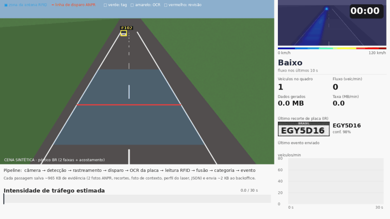
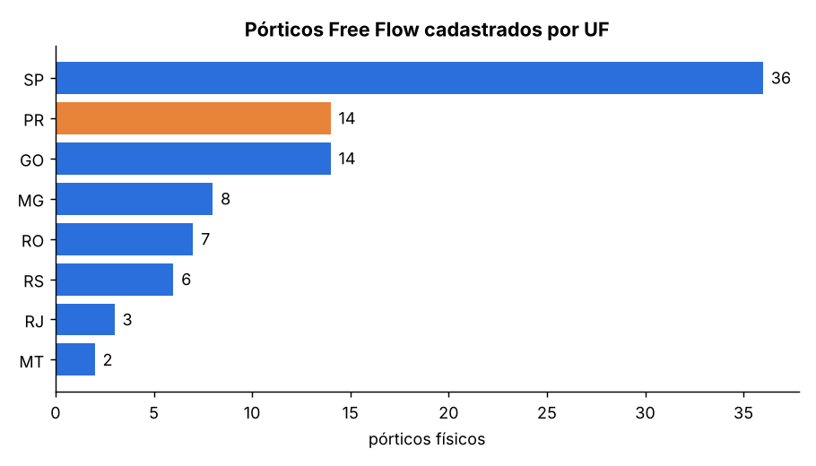
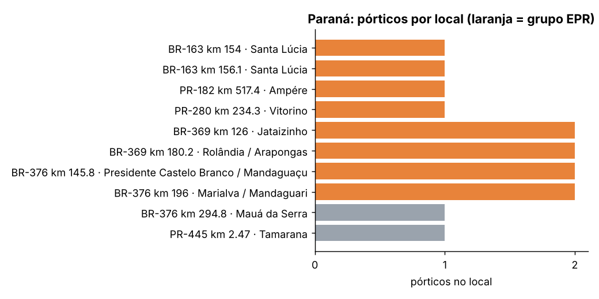
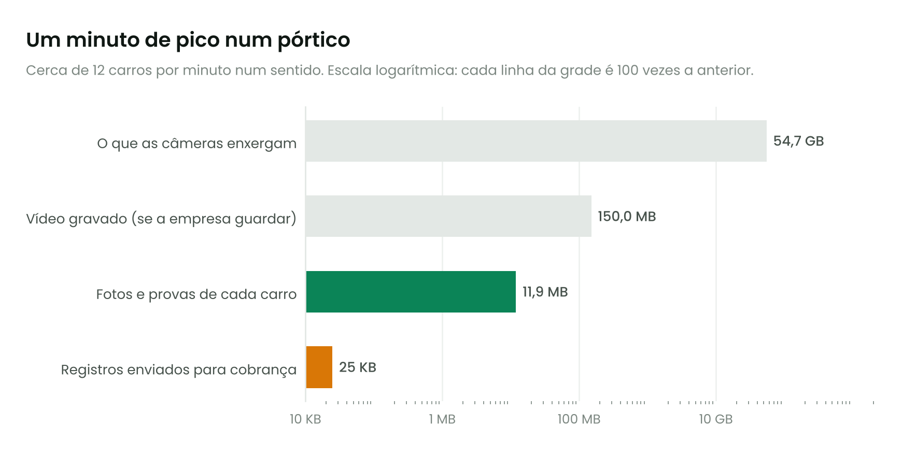
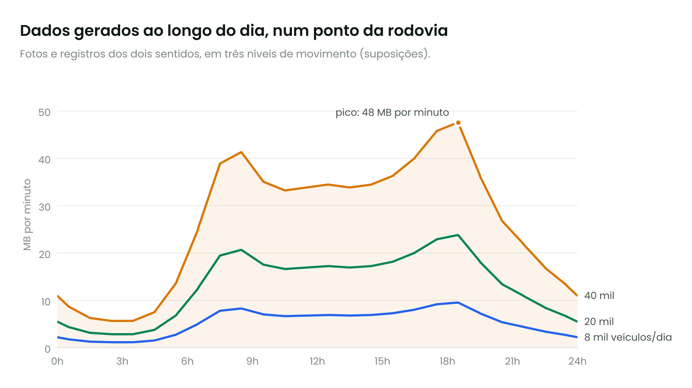

# Free Flow: quanto dado um pedágio sem cancela gera, e como ele "enxerga" os veículos

Projeto de análise de dados e visão computacional sobre o **pedágio Free Flow** no Brasil, com
foco nos pórticos da **EPR Paraná** (Lote 4: BR-369 e BR-376), que começaram a cobrar em 4 de maio de 2026.



*Simulação: o pórtico aparece na cena com os sensores de cada faixa (① câmera ANPR com flash
infravermelho, ② antena RFID, ③ laser 3D, ④ câmera de contexto) e a área que cada um cobre: a
antena lê de 0 a 16 m antes do pórtico, a câmera fotografa a placa a 10 m e o laser mede os eixos
exatamente sob a viga. Uma vista lateral embaixo mostra as mesmas distâncias. Também há
detecção e rastreamento de veículos, OCR da placa, leitura de tag RFID,
classificação por eixos e geração de dados em tempo real. **A cena é sintética**; a lógica do
pipeline segue a de um pórtico real (ver [`docs/como_funciona.md`](docs/como_funciona.md)).*

## Perguntas

1. Onde estão e quantos são os pórticos Free Flow no Brasil e no Paraná?
2. **Quantos dados um pórtico recebe por minuto?** Do sensor bruto ao registro de cobrança.
3. Como os sensores leem placas e tags a 100 km/h?

## Principais resultados

**Cadastro (dados reais, base aberta CC BY 4.0, atualizada em 26/08/2026)**

* 69 locais e **90 pórticos** cadastrados em 8 UFs, de 17 concessionárias; 61 locais já cobram.
* **Paraná: 14 pórticos em 10 locais**, sendo 12 do grupo EPR (8 da EPR Paraná e 4 da EPR Iguaçu).
* A EPR Paraná usa **um pórtico por sentido** em cada um dos 4 locais do Lote 4.

| | |
|---|---|
|  |  |

**Volume de dados (modelo paramétrico, cenários de tráfego)**

Cada passagem gera um **pacote de evidência de cerca de 965 KB** (2 fotos ANPR, recortes da placa, foto de
contexto, perfil do laser e metadados) e uma **transação de cerca de 2 KB** para o backoffice.

| Cenário (VDM por local, 2 sentidos) | Veículos/min no pico | Evidências no pico | Evidências por dia | Rede EPR Lote 4 por ano |
|---|---:|---:|---:|---:|
| Baixo: 8.000 | 10 | ~9,5 MB/min | ~7,7 GB | ~11 TB |
| Médio: 20.000 | 25 | ~24 MB/min | ~19 GB | ~28 TB |
| Alto: 40.000 | 49 | ~48 MB/min | ~39 GB | ~56 TB |

O dado útil é uma fração mínima do que os sensores capturam. Num pórtico de um sentido com 5
câmeras, o fluxo **bruto** é de cerca de **55 GB por minuto**. A borda (computador no pórtico) reduz isso
para algumas dezenas de MB de evidências e algumas dezenas de KB de transações:

| | |
|---|---|
|  |  |

> **Sobre os números de tráfego:** a contagem de veículos por pórtico da EPR não estava acessível
> neste ambiente, por isso os VDMs acima são **hipóteses declaradas** (rodovia regional, BR-369
> e eixo Maringá–Apucarana). Para usar o dado oficial, baixe o CSV da ANTT em
> `data/raw/antt/` (instruções em [`data/raw/antt/LEIA-ME.md`](data/raw/antt/LEIA-ME.md)) e
> rode `src/volume_dados.py` de novo. Os tamanhos de arquivo são valores típicos de sistemas
> ANPR, e todos são parâmetros editáveis no topo do script.

## Como os sensores funcionam (resumo)

| Sensor | O que faz | Tecnologia |
|---|---|---|
| Antena RFID | Lê a tag do para-brisa | UHF 902–928 MHz, ISO/IEC 18000-63; tag passiva, energizada pela onda da antena |
| Câmeras ANPR | Fotografam placa dianteira e traseira | Monocromáticas, *global shutter*, flash infravermelho, exposição de microssegundos |
| OCR | Lê os 7 caracteres da placa | Rede de detecção (YOLO) + rede de leitura (CRNN), validação pelo formato Mercosul |
| Laser 3D | Mede perfil e eixos para definir a categoria | LiDAR sobre cada faixa |
| Computador de borda | Junta tudo e gera o evento | Fusão por horário e faixa; tag manda, placa confere |

Explicação completa, com diagrama e tabela de decisão: **[`docs/como_funciona.md`](docs/como_funciona.md)**.

## Estrutura

```
data/raw/sem_parar/      cadastro aberto de pórticos, rodovias e concessionárias (CC BY 4.0)
data/raw/antt/           (opcional) CSV oficial de volume de tráfego da ANTT
src/analise_porticos.py  análise exploratória do cadastro -> figuras 01-03
src/volume_dados.py      modelo de volume de dados em 4 camadas -> figuras 04-05 e tabela
src/simulador_portico.py simulação visual do pórtico -> MP4, GIF, PNG e eventos_simulados.csv
reports/figures/         gráficos e vídeo
reports/tabelas/         tabelas geradas
docs/como_funciona.md    como tag, placa e laser são lidos
```

## Como rodar

```bash
pip install -r requirements.txt
python src/analise_porticos.py
python src/volume_dados.py
python src/simulador_portico.py --segundos 30 --seed 42
```

## Limitações e próximos passos

* Os VDMs são cenários; o próximo passo é calibrar com o CSV diário da ANTT.
* A simulação usa uma cena gerada por código; um passo seguinte seria trocar por vídeo real de
  rodovia com um detector treinado (YOLOv8) e um OCR de placas (ex.: dataset brasileiro RodoSol-ALPR).
* Ideias de modelos: previsão de demanda por pórtico, probabilidade de inadimplência (sem tag),
  detecção de placa clonada (mesma placa em pórticos distantes em tempo impossível).

## Fontes

* Cadastro de pórticos e concessionárias: [Sem-Parar/SEM-PARAR-FREE-FLOW](https://github.com/Sem-Parar/SEM-PARAR-FREE-FLOW) (CC BY 4.0), que cita a [ANTT, Free Flow](https://www.gov.br/antt/pt-br/free-flow)
* Volume de tráfego (para calibrar): [ANTT, dados abertos](https://dados.antt.gov.br/dataset/volume-trafego-praca-pedagio)
* Início da cobrança na EPR Paraná: [Bem Paraná](https://www.bemparana.com.br/noticias/parana/free-flow-comeca-a-ser-cobrado-nesta-segunda-feira-no-parana-veja-em-quais-pontos/), [Banda B](https://www.bandab.com.br/noticias-parana/epr-parana-recebe-autorizacao-da-antt-para-cobrar-pedagio-eletronico-em-quatro-porticos/amp/)
