# Barrier-free tolling: what happens when you drive under the gantry

*Leia em português: [README.pt-BR.md](README.pt-BR.md)*

You drive at 100 km/h under a steel frame. You don't brake, you don't roll down the window, and a
few days later the toll shows up on your bill. I wanted to understand what happens in that half
second: who reads the plate, who reads the tag, how much data it produces, and where it can go
wrong.

The starting point was the gantries run by EPR Paraná on highways BR-369 and BR-376, in southern
Brazil, which started charging on May 4, 2026. In Brazil this system is called *Free Flow*.

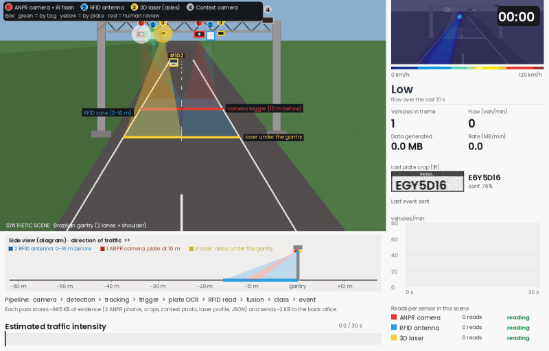

*The scene above is generated by code; it is not real footage. The numbers on the gantry show
where each sensor sits: (1) the camera that photographs the plate, (2) the antenna that reads
the tag, (3) the laser that counts axles and (4) the camera that takes the wide shot. The strip
at the bottom shows the same thing from the side, with distances. The full explanation is in
[`docs/how_it_works.md`](docs/how_it_works.md).*

## What I wanted to answer

1. How many of these gantries exist in Brazil and in the state of Paraná?
2. How much data does one gantry receive per minute?
3. How does a camera read a plate at 100 km/h, and how does the antenna read the tag?
4. Can machine learning make fewer mistakes and spend less?

## How many gantries there are

This part uses real data: an open registry (CC BY 4.0 license, updated on 2026-08-26) that pulls
together information from ANTT, Brazil's federal land-transport regulator, and from the toll
concessionaires.

Today there are 90 gantries in 8 states. Paraná has 14, and 8 of them belong to EPR Paraná: one
per direction at four sites, Jataizinho and Arapongas on BR-369, and Presidente Castelo Branco
and Mandaguari on BR-376.

| | |
|---|---|
| 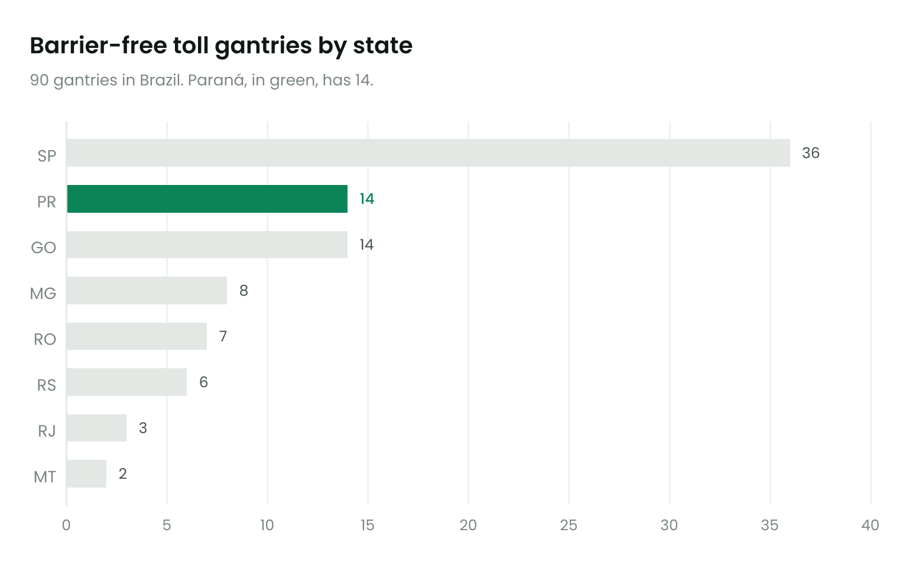 | 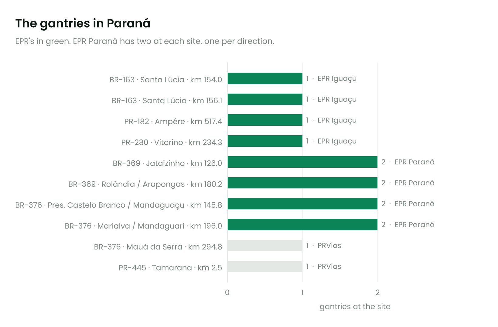 |

## How much data one gantry produces

Every car leaves behind about 1 MB of evidence: two photos of the plate, a wide photo, crops of
the plate, the profile measured by the laser, and a record of the read. What goes to the billing
system is much smaller, about 2 KB.

I could not get the official vehicle count for each gantry, so I worked with three traffic
scenarios. They are my assumptions, not measurements:

| Traffic (vehicles per day, both directions) | Cars per minute at peak | Data at peak | Data per day | The 4 EPR sites in a year |
|---|---:|---:|---:|---:|
| 8,000, regional road | 10 | 9.5 MB/min | 7.7 GB | 11 TB |
| 20,000, similar to BR-369 | 25 | 24 MB/min | 19 GB | 28 TB |
| 40,000, Maringá–Apucarana stretch | 49 | 48 MB/min | 39 GB | 56 TB |

What surprised me most was the gap between what the cameras capture and what is left at the end.
The five cameras on a gantry see about 55 GB per minute. Almost all of it is processed and thrown
away right there, on the computer that sits on the gantry. What moves on to billing fits in a few
dozen KB.

| | |
|---|---|
| 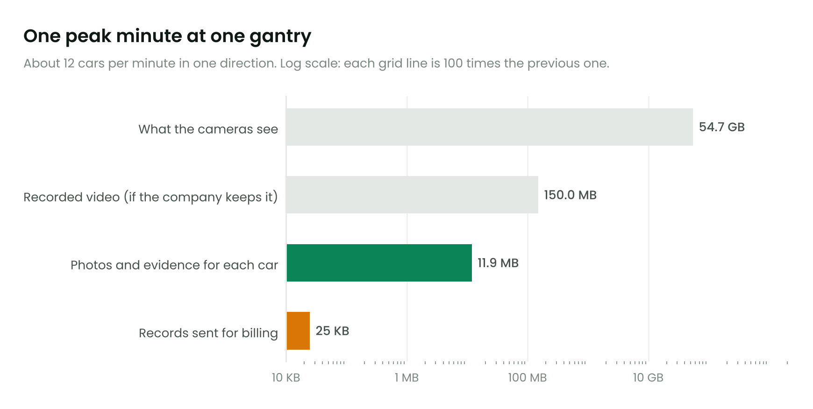 | 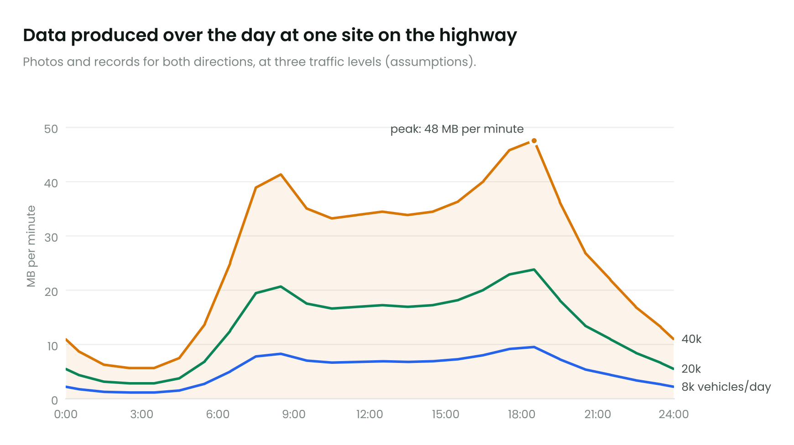 |

If you download ANTT's official traffic file and drop it into `data/raw/antt/` (steps in
[`data/raw/antt/README.md`](data/raw/antt/README.md)), the script swaps my assumptions for the
real numbers. Photo sizes can also be changed at the top of `src/data_volume.py`.

## How the sensors read the car

The tag is a sticker with no battery. The gantry's antenna sends out a radio wave, the wave
itself powers the chip, and the chip answers with its code. It takes a few thousandths of a
second.

The plate is photographed by black-and-white cameras with an infrared flash. The shot is fast
enough to freeze a car at 120 km/h. One program finds the plate in the image and another reads
the seven letters and digits. If the read comes out doubtful, a person checks the photo.

The laser, hanging over each lane, measures the size of the vehicle and counts its axles. That is
how the system knows whether to charge a car rate or a truck rate.

When the car has a tag, the toll goes through the tag and the plate photo is used as a check.
Without a tag, the toll goes by the plate, and the driver has 30 days to pay.

## Machine learning: fewer mistakes, lower cost

To train models I needed far more passes than the video has. So I wrote a generator: 104,000
passes over 3 days and 4 gantries, with night, rain, dirty plates, tags stuck on the wrong car,
and two cameras failing on the last day. Since the generator knows every car's true plate, I can
measure exactly how often each method is right. The models learn from the first two days and are
tested on the third, which they never saw.

One caveat before the numbers: the data is simulated. It shows whether the idea works and the
rough size of the gain, not the results of a real gantry. The costs (R$ 0.60 for each photo a
person checks and R$ 30 for each wrong charge, in Brazilian reais) are also my assumptions.

### 1. Deciding when to bill automatically and when to call a person

The usual rule is simple: if the tag was read, bill it; if the camera is 90% sure of the plate,
bill it; otherwise a person checks. The problem is that those 90% don't mean 90%. The camera is
too optimistic.

I trained a model that looks at 18 clues at once (how sure each camera is, whether the photos
agree, whether the tag's plate matches the photographed plate, whether the plate exists in the
vehicle registry, whether the size measured by the laser matches the registry, whether it was
raining...) and estimates the real chance of being right. Then I picked the cut-off that makes
the total cost lowest. ([code](src/ml/exp1_fusion_threshold.py))

| Test day (34,644 passes) | Billed automatically | Checked by a person | Wrong charges | Cost per 10,000 passes |
|---|---:|---:|---:|---:|
| Usual rule | 98.8% | 1.2% | 422 | R$ 3,729 |
| Usual rule with the best possible cut-off | 92.3% | 7.7% | 188 | R$ 2,091 |
| Model | 95.7% | 4.3% | 17 | R$ 405 |

The model sends a few more photos to be checked, but wrong charges drop from 422 to 17. The clue
that mattered most was the difference between the tag's plate and the photographed plate. That is
what exposes a tag stuck on another car, a mistake the usual rule never notices.

| | |
|---|---|
| 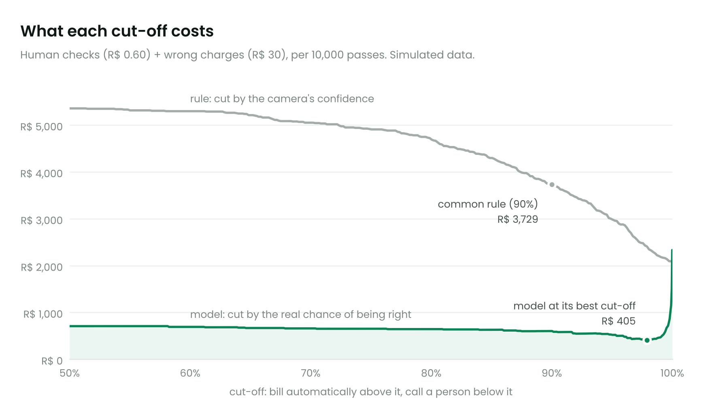 | 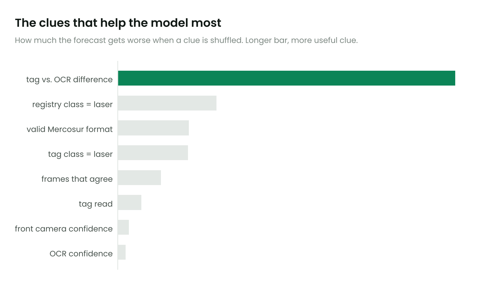 |

### 2. Fixing the plate read with the Mercosur format

Brazil's Mercosur plates always follow the same pattern: three letters, a digit, a letter, two
digits. If the camera read a zero in the third position, it can only be the letter O. And since
the camera takes several photos of each car, I can run a vote, character by character, across
them. ([code](src/ml/exp2_mercosur_correction.py))

| Method (passes without a tag) | Plates read correctly | Errors per 10,000 | Reduction |
|---|---:|---:|---:|
| Use only the best photo | 95.4% | 456 | |
| Best photo + format rule | 96.6% | 335 | 26% |
| Vote across photos + format rule | 96.8% | 321 | 30% |
| Model that learns which characters the camera confuses | 96.7% | 329 | 28% |

The vote won, and the fancier model did not beat it. The reason was the most interesting part of
the experiment: 81% of the errors left over are on dirty, bent or covered plates. The camera
misreads those the same way in every photo, so voting doesn't help. They need a person, and the
model from section 1 is what singles them out.

| | |
|---|---|
| 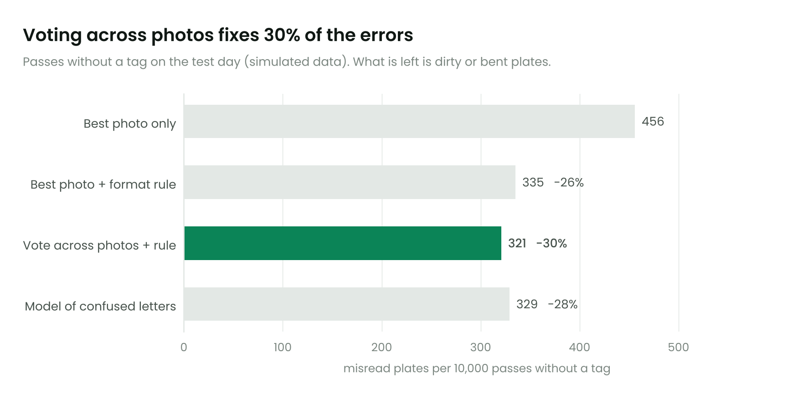 | 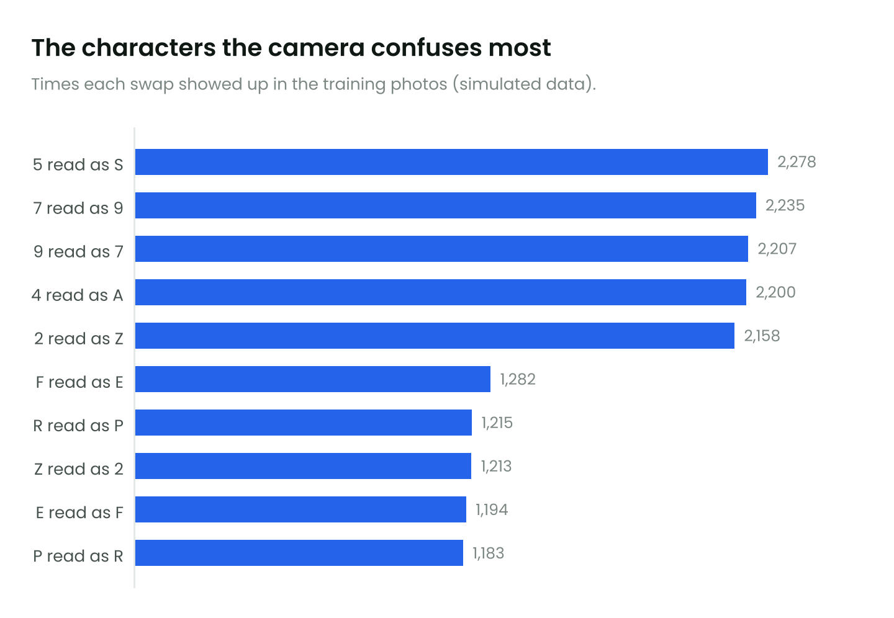 |

### 3. Noticing when a camera starts to fail

Every 10 minutes I tracked how many plates each camera reads with confidence. The obvious way to
watch this is to sound an alarm when the rate drops below 85%. But it drops every time it rains
or gets dark, and the alarm turns into noise.

So a model learns how much each camera usually reads at that hour, in that weather, and the alarm
only goes off when the camera stays below that for a while (a method called CUSUM).
([code](src/ml/exp3_sensor_health.py))

| | Simple alarm (below 85%) | Alarm with the model |
|---|---:|---:|
| False alarms in 3 days | 172 | 0 |
| Infrared flash burns out, at night | fired, but it was already firing for no reason | within the first 10 minutes |
| Lens slowly getting dirty | 20 minutes, buried among false alarms | 30 minutes |

The simple alarm was faster on the dirty lens only because it goes off all the time. Nobody
trusts an alarm that went off 172 times for nothing.

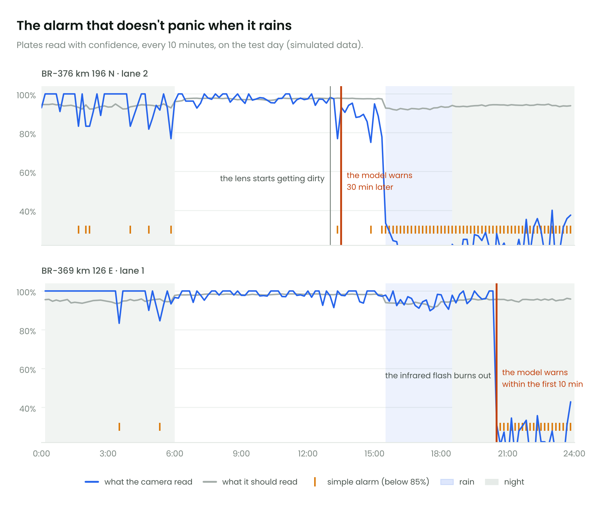

## Taking better care of this data

The summary is below. The long version, with the validation checks and the indicators I would
put on a dashboard, is in [`docs/data_optimization.md`](docs/data_optimization.md).

| Where | What to do | Gain |
|---|---|---|
| On the gantry | Process the images right there and send only the result | from 55 GB per minute to 2 KB per car |
| Reading the plate | Vote across the photos and apply the Mercosur format rule | 30% fewer misread plates |
| Deciding to bill | Use the real chance of being right and a cost-based cut-off | 96% fewer wrong charges |
| Before billing | Check format, registry, tag vs. plate, tag vs. laser, duplicates and timestamps | catches tag fraud before the charge |
| Storage | Keep every photo only when it may be needed as evidence | 59% less storage per day |
| Day to day | Compare each camera with what it should be reading | faults noticed in 10 to 30 minutes, no false alarms |
| Over time | Use the checks done by people to retrain the model | the model improves with use |

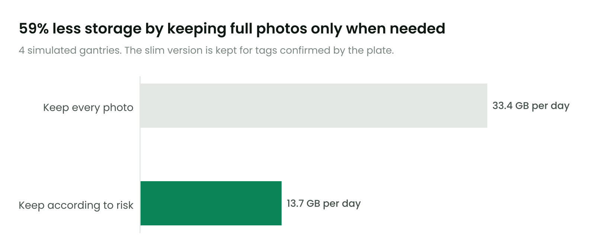

## How the project is organized

```
data/raw/sem_parar/       open registry of gantries and concessionaires (CC BY 4.0)
data/raw/antt/            place for ANTT's official traffic file (optional)
src/gantry_analysis.py    gantry charts (figures 01 to 03)
src/data_volume.py        data-per-minute model (figures 04 and 05)
src/gantry_simulator.py   the video simulation
src/style.py              shared chart style (Poppins font in assets/fonts)
src/ml/generate_events.py the pass generator for the models
src/ml/exp1_*.py          deciding when to bill automatically + storage policy
src/ml/exp2_*.py          plate correction with the Mercosur format
src/ml/exp3_*.py          alarm for a failing camera
reports/                  charts, video and tables
docs/how_it_works.md      how the tag, the plate and the laser are read
docs/data_optimization.md how to take better care of the data
```

## How to run it

```bash
pip install -r requirements.txt
python src/gantry_analysis.py
python src/data_volume.py
python src/gantry_simulator.py --seconds 30 --seed 42

# machine learning (about 1 minute in total)
python src/ml/generate_events.py
python src/ml/exp1_fusion_threshold.py
python src/ml/exp2_mercosur_correction.py
python src/ml/exp3_sensor_health.py
```

## What is still missing

Traffic volume is still an assumption. The next step is to run everything with ANTT's daily
file.

The simulation is drawn by code. I would like to swap it for real highway footage, with a trained
detector (YOLOv8) and a Brazilian plate reader trained on the RodoSol-ALPR dataset.

With real data, the right answer would come from the checks people do. That brings a new concern:
you only know the truth for the cases someone checked, and that skews training unless someone
also checks a sample of the passes billed automatically.

I also want to chain the experiments (feed the corrected plate from section 2 into section 1) and
try other ideas: forecast traffic at each gantry, predict who won't pay on time, and find cloned
plates (the same plate at two distant gantries within an impossible time).

## Sources

* Gantry and concessionaire registry: [Sem-Parar/SEM-PARAR-FREE-FLOW](https://github.com/Sem-Parar/SEM-PARAR-FREE-FLOW) (CC BY 4.0), based on [ANTT's Free Flow page](https://www.gov.br/antt/pt-br/free-flow)
* Official traffic, for anyone who wants to replace the assumptions: [ANTT open data](https://dados.antt.gov.br/dataset/volume-trafego-praca-pedagio)
* Start of charging at EPR Paraná (in Portuguese): [Bem Paraná](https://www.bemparana.com.br/noticias/parana/free-flow-comeca-a-ser-cobrado-nesta-segunda-feira-no-parana-veja-em-quais-pontos/), [Banda B](https://www.bandab.com.br/noticias-parana/epr-parana-recebe-autorizacao-da-antt-para-cobrar-pedagio-eletronico-em-quatro-porticos/amp/)
