# Pedágio sem cancela: o que acontece quando você passa pelo pórtico

*Read in English: [README.md](README.md). Os gráficos, o vídeo e o código estão em inglês.*

Você passa a 100 km/h por baixo de uma estrutura de metal, não freia, não abre o vidro, e dias
depois a cobrança aparece. Eu queria entender o que acontece nesse meio segundo: quem lê a
placa, quem lê a tag, quantos dados isso gera e onde dá para errar.

O ponto de partida foram os pórticos da EPR Paraná na BR-369 e na BR-376, que começaram a
cobrar em 4 de maio de 2026.

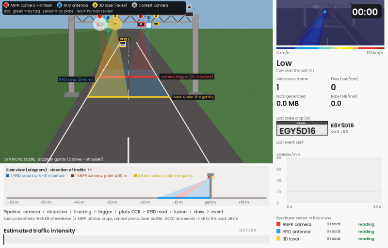

*A cena acima é gerada por código, não é vídeo real. Os números no pórtico mostram onde fica
cada sensor: (1) a câmera que fotografa a placa, (2) a antena que lê a tag, (3) o laser que
conta os eixos e (4) a câmera que tira a foto geral. A faixa de baixo mostra a mesma coisa de
lado, com as distâncias. A explicação completa está em [`docs/pt-BR/como_funciona.md`](docs/pt-BR/como_funciona.md).*

## O que eu quis responder

1. Quantos pórticos desse tipo existem no Brasil e no Paraná?
2. Quantos dados um pórtico recebe por minuto?
3. Como uma câmera lê uma placa a 100 km/h, e como a antena lê a tag?
4. Dá para usar machine learning para errar menos e gastar menos?

## Quantos pórticos existem

Esta parte usa dados reais: um cadastro aberto (licença CC BY 4.0, atualizado em 26/08/2026)
que junta informações da ANTT e das concessionárias.

Hoje são 90 pórticos em 8 estados. O Paraná tem 14, e 8 deles são da EPR Paraná, um em cada
sentido da pista em quatro pontos: Jataizinho e Arapongas, na BR-369, e Presidente Castelo
Branco e Mandaguari, na BR-376.

| | |
|---|---|
| 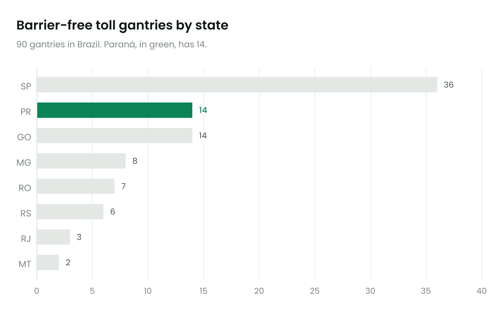 | 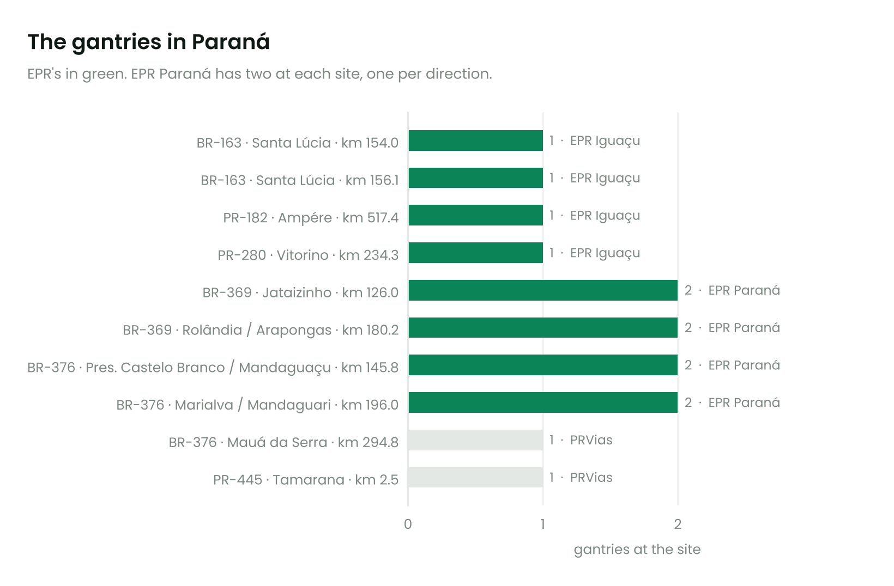 |

## Quantos dados um pórtico gera

Cada carro que passa deixa para trás cerca de 1 MB de provas (duas fotos da placa, uma foto
geral, recortes da placa, o perfil medido pelo laser e um registro com os dados da leitura). Para
o sistema de cobrança vai bem menos, uns 2 KB.

Não consegui acessar a contagem oficial de veículos de cada pórtico, então trabalhei com três
cenários de movimento. Eles são suposições minhas, não medições:

| Movimento (veículos por dia, nos dois sentidos) | Carros por minuto no horário de pico | Dados no pico | Dados por dia | Os 4 pontos da EPR em um ano |
|---|---:|---:|---:|---:|
| 8.000, rodovia regional | 10 | 9,5 MB/min | 7,7 GB | 11 TB |
| 20.000, parecido com a BR-369 | 25 | 24 MB/min | 19 GB | 28 TB |
| 40.000, trecho Maringá–Apucarana | 49 | 48 MB/min | 39 GB | 56 TB |

O que mais me surpreendeu foi a diferença entre o que as câmeras captam e o que sobra no fim.
As cinco câmeras de um pórtico enxergam cerca de 55 GB por minuto. Quase tudo é processado e
jogado fora ali mesmo, no computador que fica no pórtico. O que segue para a cobrança cabe em
algumas dezenas de KB.

| | |
|---|---|
| 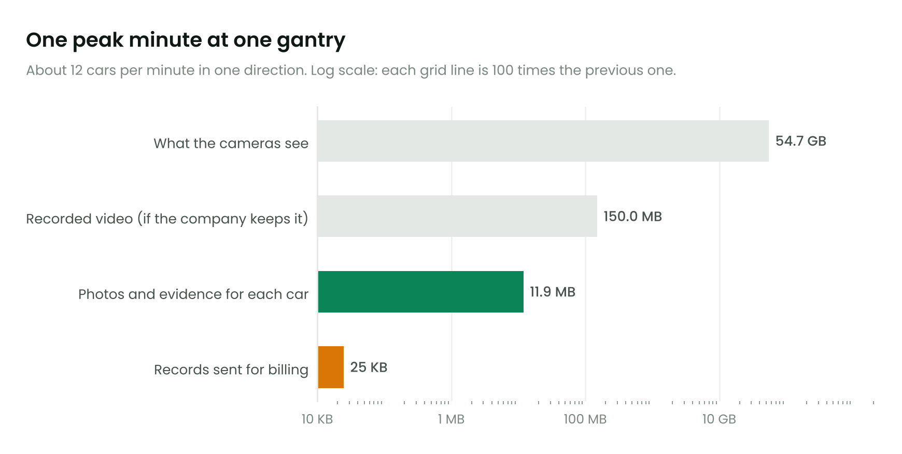 | 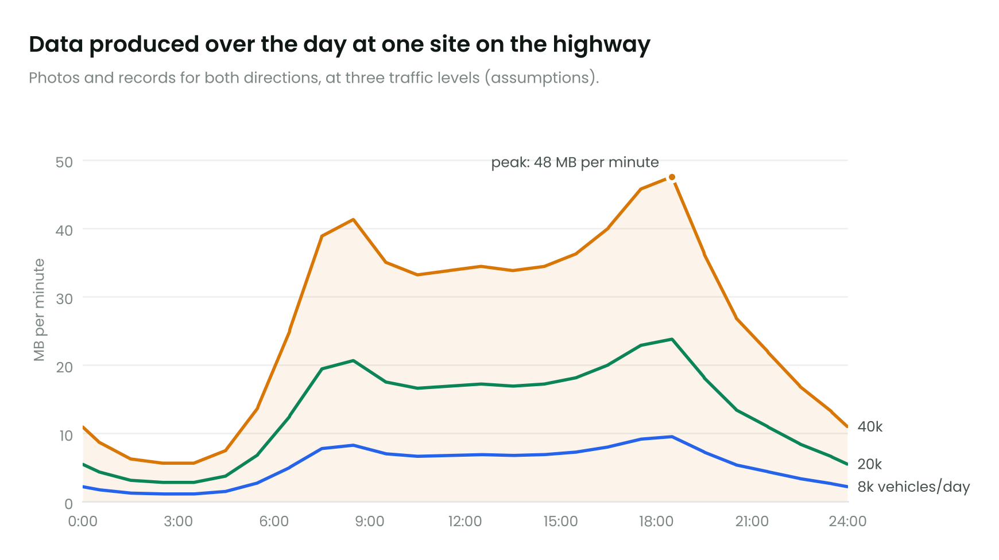 |

Se você baixar o arquivo oficial de tráfego da ANTT e colocar em `data/raw/antt/` (o passo a
passo está em [`data/raw/antt/README.md`](data/raw/antt/README.md)), o script troca minhas
suposições pelos números reais. Os tamanhos de foto também podem ser ajustados no começo de
`src/data_volume.py`.

## Como os sensores leem o carro

A tag é um adesivo sem bateria. A antena do pórtico manda uma onda de rádio, a própria onda
alimenta o chip, e ele responde com o seu código. Isso leva milésimos de segundo.

A placa é fotografada por câmeras em preto e branco com flash infravermelho. A foto é tão rápida
que congela um carro a 120 km/h. Um programa acha a placa na imagem e outro lê as sete letras e
números. Se a leitura sair duvidosa, uma pessoa confere a foto.

O laser, pendurado sobre cada faixa, mede o tamanho do veículo e conta os eixos. É assim que o
sistema sabe se cobra tarifa de carro ou de caminhão.

Quando o carro tem tag, a cobrança vai pela tag e a foto da placa serve para conferir. Sem tag,
a cobrança vai pela placa, e o motorista tem 30 dias para pagar.

## Machine learning: errar menos e gastar menos

Para treinar modelos eu precisava de muito mais passagens do que o vídeo tem. Então escrevi um
gerador: 104 mil passagens em 3 dias e 4 pórticos, com noite, chuva, placas sujas, tag colada no
carro errado e duas câmeras com defeito no último dia. Como o gerador sabe a placa verdadeira de
cada carro, dá para medir exatamente quanto cada método acerta. Os modelos aprendem com os dois
primeiros dias e são testados no terceiro, que eles nunca viram.

Uma ressalva antes dos números: os dados são simulados. Eles mostram se a ideia funciona e o
tamanho aproximado do ganho, não o resultado de um pórtico de verdade. Os custos (R$ 0,60 por
foto conferida por uma pessoa e R$ 30 por cobrança errada) também são suposições minhas.

### 1. Decidir quando cobrar sozinho e quando chamar uma pessoa

A regra comum é simples: se leu a tag, cobra; se a câmera tem 90% de certeza da placa, cobra;
senão, uma pessoa confere. O problema é que esses 90% não querem dizer 90%. A câmera é
otimista demais.

Treinei um modelo que olha para 18 pistas ao mesmo tempo (a certeza das duas câmeras, se as
fotos concordam entre si, se a placa da tag bate com a placa fotografada, se a placa existe no
cadastro, se o tamanho medido pelo laser bate com o cadastro, se estava chovendo...) e calcula a
chance real de acerto. Depois escolhi o ponto de corte que deixa o custo total mais baixo.
([código](src/ml/exp1_fusion_threshold.py))

| Dia de teste (34.644 passagens) | Cobrado sozinho | Conferido por uma pessoa | Cobranças erradas | Custo a cada 10 mil passagens |
|---|---:|---:|---:|---:|
| Regra comum | 98,8% | 1,2% | 422 | R$ 3.729 |
| Regra com o melhor corte possível | 92,3% | 7,7% | 188 | R$ 2.091 |
| Modelo | 95,7% | 4,3% | 17 | R$ 405 |

O modelo manda um pouco mais de fotos para conferência, mas as cobranças erradas caem de 422
para 17. A pista que mais pesou foi a diferença entre a placa da tag e a placa fotografada: é ela
que denuncia a tag colada em outro carro, um erro que a regra comum nunca percebe.

| | |
|---|---|
| 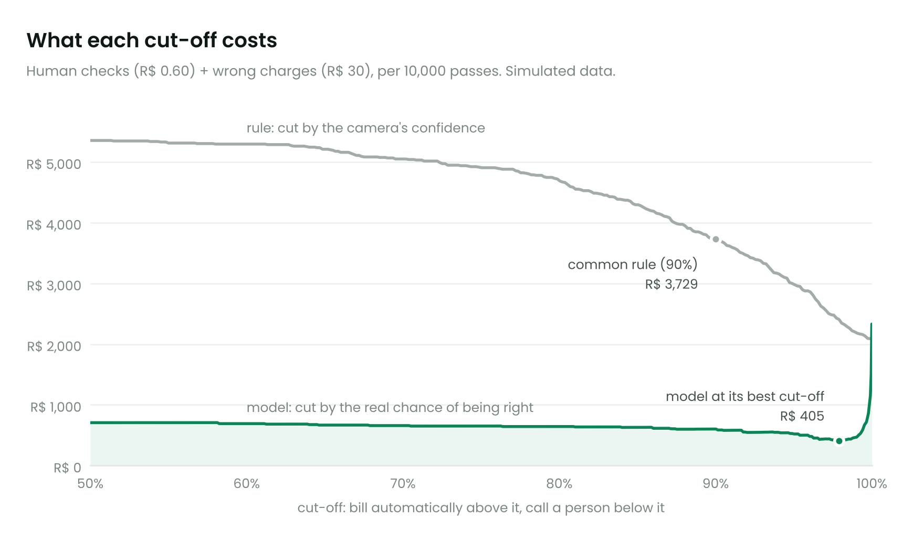 | 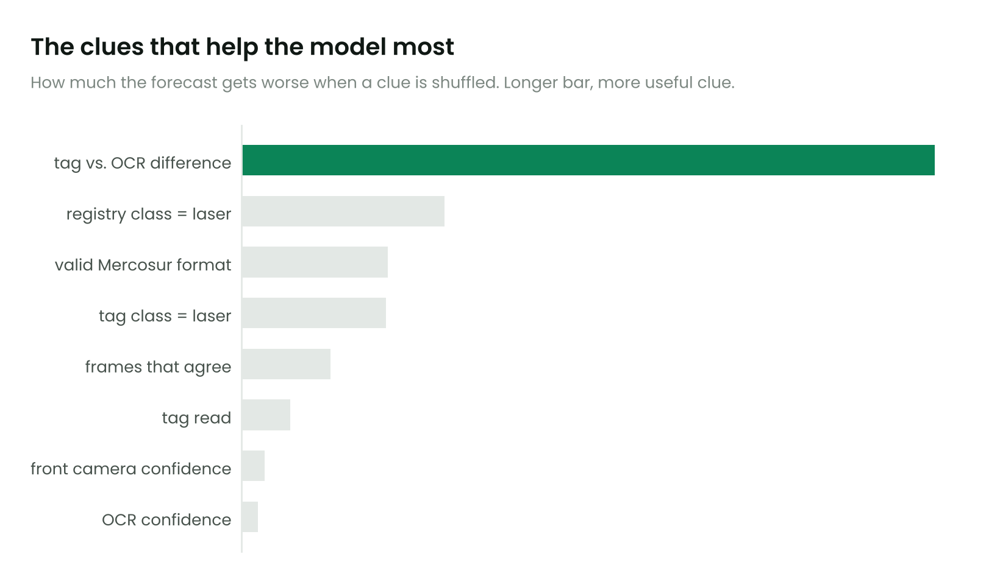 |

### 2. Consertar a leitura da placa usando o formato Mercosul

A placa Mercosul segue sempre o mesmo desenho: três letras, um número, uma letra, dois números.
Se a câmera leu um zero na terceira posição, só pode ser a letra O. E como a câmera tira várias
fotos de cada carro, dá para fazer uma votação letra por letra entre elas.
([código](src/ml/exp2_mercosur_correction.py))

| Método (passagens sem tag) | Placas lidas certo | Erros a cada 10 mil | Redução |
|---|---:|---:|---:|
| Usar só a melhor foto | 95,4% | 456 | |
| Melhor foto + regra do formato | 96,6% | 335 | 26% |
| Votação entre as fotos + regra do formato | 96,8% | 321 | 30% |
| Modelo que aprende quais letras a câmera confunde | 96,7% | 329 | 28% |

A votação venceu, e o modelo mais sofisticado não ganhou dela. O motivo foi a parte mais
interessante do experimento: 81% dos erros que sobraram estão em placas sujas, amassadas ou
tampadas. Essas a câmera lê errado do mesmo jeito em todas as fotos, então votar não adianta.
Elas precisam de uma pessoa, e quem separa esses casos é o modelo do item 1.

| | |
|---|---|
| 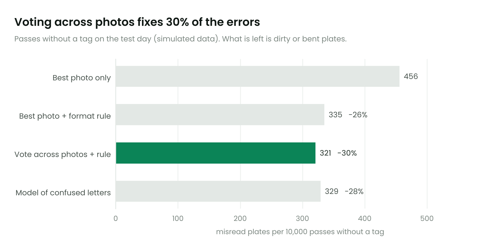 | 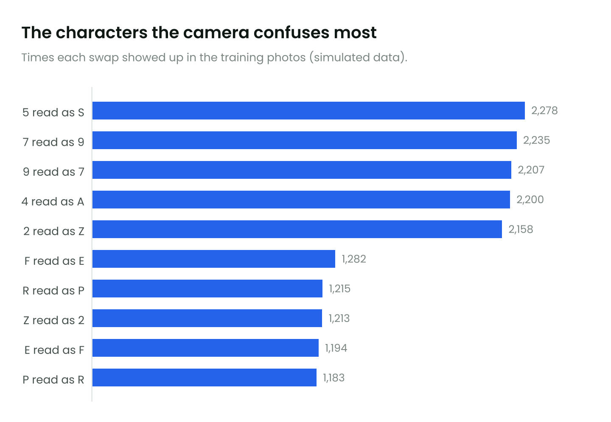 |

### 3. Perceber quando uma câmera começa a falhar

Acompanhei, a cada 10 minutos, quantas placas cada câmera lê com segurança. O jeito óbvio de
vigiar isso é tocar um alarme quando a taxa cai abaixo de 85%. Só que ela cai toda vez que chove
ou anoitece, e o alarme vira barulho.

Então um modelo aprende quanto cada câmera costuma ler naquela hora, com aquele tempo, e o
alarme só toca quando a câmera fica abaixo do esperado por um período seguido (um método
chamado CUSUM). ([código](src/ml/exp3_sensor_health.py))

| | Alarme simples (abaixo de 85%) | Alarme com o modelo |
|---|---:|---:|
| Alarmes falsos em 3 dias | 172 | 0 |
| Flash infravermelho queimado, à noite | tocou, mas já tocava antes à toa | nos primeiros 10 minutos |
| Lente ficando suja aos poucos | 20 minutos, no meio dos alarmes falsos | 30 minutos |

O alarme simples foi mais rápido na lente suja só porque toca o tempo todo. Ninguém confia num
alarme que tocou 172 vezes sem motivo.

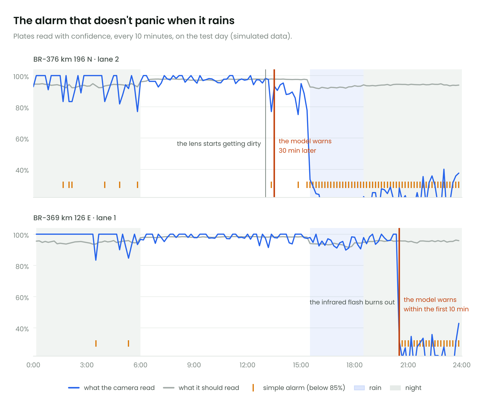

## Como cuidar melhor desses dados

O resumo está abaixo. A versão longa, com as regras de checagem e os indicadores que eu
acompanharia num painel, está em [`docs/pt-BR/otimizacao_dados.md`](docs/pt-BR/otimizacao_dados.md).

| Onde | O que fazer | Ganho |
|---|---|---|
| No pórtico | Processar as imagens ali mesmo e enviar só o resultado | de 55 GB por minuto para 2 KB por carro |
| Na leitura | Votar entre as fotos e aplicar a regra do formato Mercosul | 30% menos placas erradas |
| Na decisão | Usar a chance real de acerto e um corte baseado em custo | 96% menos cobranças erradas |
| Antes de cobrar | Checar formato, cadastro, tag contra placa, tag contra laser, duplicidade e horário | pega fraude de tag antes da cobrança |
| No armazenamento | Guardar todas as fotos só quando elas podem ser pedidas como prova | 59% menos espaço por dia |
| No dia a dia | Comparar cada câmera com o que ela deveria estar lendo | defeito percebido em 10 a 30 minutos, sem alarme falso |
| Com o tempo | Usar as conferências feitas por pessoas para treinar o modelo de novo | o modelo melhora com o uso |

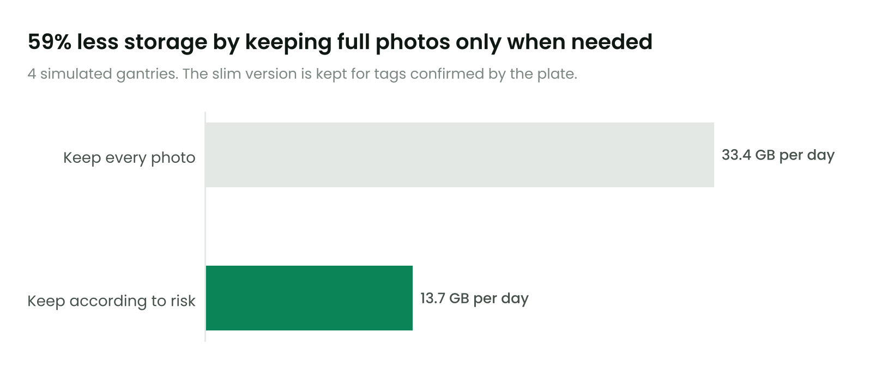

## Como o projeto está organizado

```
data/raw/sem_parar/       cadastro aberto de pórticos e concessionárias (CC BY 4.0)
data/raw/antt/            lugar para o arquivo oficial de tráfego da ANTT (opcional)
src/gantry_analysis.py    gráficos dos pórticos (figuras 01 a 03)
src/data_volume.py        cálculo de dados por minuto (figuras 04 e 05)
src/gantry_simulator.py   a simulação em vídeo
src/ml/generate_events.py   o gerador de passagens para os modelos
src/ml/exp1_*.py          decidir quando cobrar sozinho + política de armazenamento
src/ml/exp2_*.py          correção da placa pelo formato Mercosul
src/ml/exp3_*.py          alarme de câmera com defeito
reports/                  gráficos, vídeo e tabelas
docs/pt-BR/como_funciona.md  como tag, placa e laser são lidos
docs/pt-BR/otimizacao_dados.md como cuidar melhor dos dados
```

## Como rodar

```bash
pip install -r requirements.txt
python src/gantry_analysis.py
python src/data_volume.py
python src/gantry_simulator.py --seconds 30 --seed 42

# machine learning (cerca de 1 minuto ao todo)
python src/ml/generate_events.py
python src/ml/exp1_fusion_threshold.py
python src/ml/exp2_mercosur_correction.py
python src/ml/exp3_sensor_health.py
```

## O que ainda falta

O movimento de veículos ainda é suposição. O próximo passo é rodar tudo com o arquivo diário da
ANTT.

A simulação é desenhada por código. Eu gostaria de trocar por vídeo real de rodovia, com um
detector treinado (YOLOv8) e um leitor de placas brasileiras treinado no conjunto RodoSol-ALPR.

Com dados reais, a resposta certa viria das conferências feitas por pessoas. Aí aparece um
cuidado novo: só se sabe a verdade dos casos que alguém conferiu, e isso distorce o treino se
ninguém olhar também uma amostra dos casos cobrados automaticamente.

Também quero ligar os experimentos (usar a placa corrigida do item 2 como entrada do item 1) e
testar outras ideias: prever o movimento de cada pórtico, prever quem não vai pagar no prazo e
achar placa clonada (a mesma placa em dois pórticos distantes num intervalo de tempo impossível).

## Fontes

* Cadastro de pórticos e concessionárias: [Sem-Parar/SEM-PARAR-FREE-FLOW](https://github.com/Sem-Parar/SEM-PARAR-FREE-FLOW) (CC BY 4.0), que se baseia na [página de Free Flow da ANTT](https://www.gov.br/antt/pt-br/free-flow)
* Tráfego oficial, para quem quiser trocar as suposições: [ANTT, dados abertos](https://dados.antt.gov.br/dataset/volume-trafego-praca-pedagio)
* Início da cobrança na EPR Paraná: [Bem Paraná](https://www.bemparana.com.br/noticias/parana/free-flow-comeca-a-ser-cobrado-nesta-segunda-feira-no-parana-veja-em-quais-pontos/), [Banda B](https://www.bandab.com.br/noticias-parana/epr-parana-recebe-autorizacao-da-antt-para-cobrar-pedagio-eletronico-em-quatro-porticos/amp/)
